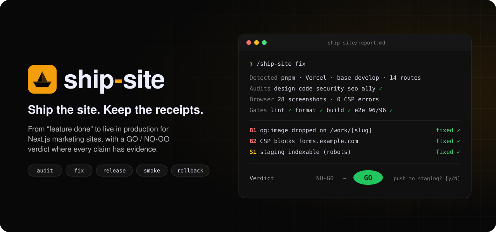
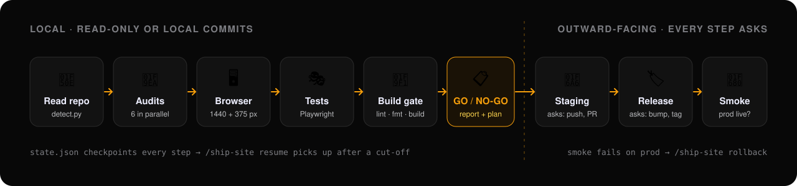
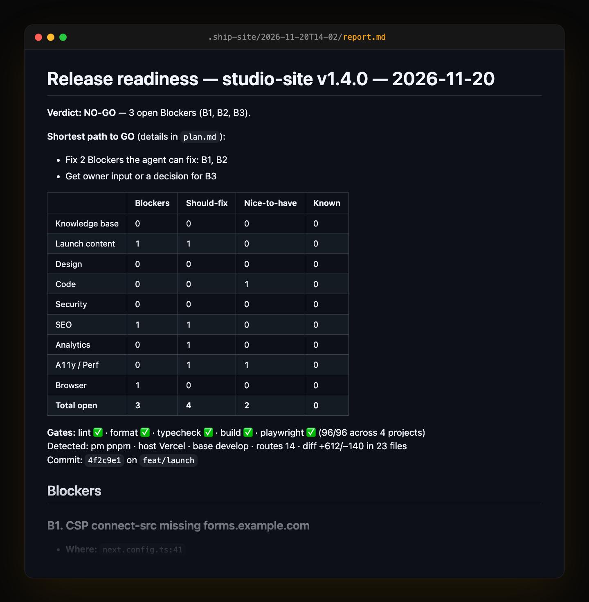
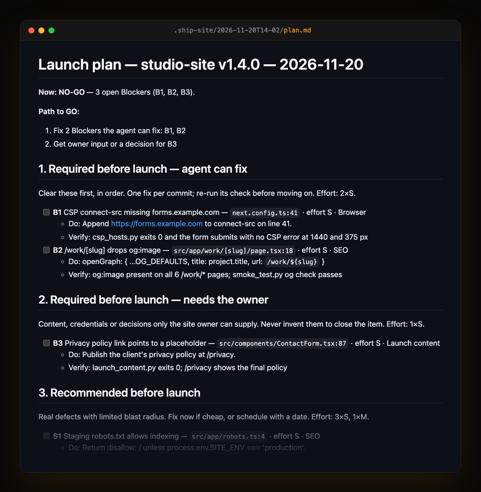

<div align="center">

<h1>
  <picture>
    <source media="(prefers-color-scheme: dark)" srcset="./assets/brand/logo-mark-reverse.svg">
    <source media="(prefers-color-scheme: light)" srcset="./assets/brand/logo-mark.svg">
    
  </picture>
  ship-site
</h1>

**Ship the site. Keep the receipts.**

[](https://github.com/saroj-shahi/ship-site/actions/workflows/ci.yml)
[](LICENSE)
[](https://github.com/saroj-shahi/ship-site/stargazers)
[](https://buymeacoffee.com/sarojshahi)

[](#install)
[](#install)
[](#install)
[](#install)
[](#install)
[](#install)



[**Install**](#install) · [**Use**](#use) · [**What it checks**](#what-it-checks) · [**Safety**](#safety-model) · [**Scripts**](#standalone-scripts) · [**Support**](#support)

</div>

## What it does

Tell your agent *"is this ready to ship?"* It reads your Next.js marketing site, runs the design, code, security, SEO, analytics, accessibility and performance audits in parallel, clicks through every route in a real browser, runs your tests and build, and hands you a **GO / NO-GO** report and an ordered **launch plan**. Every claim in them carries evidence: a screenshot, a log line or a test name.

Say *"ship it"* and it carries on through staging, the version bump, the release PR, the tag and a post-deploy smoke test, stopping to ask before every step that leaves your machine.

It replaces the release checklist people run by hand and get wrong at 6pm on a Friday: `og:image` silently dropped by a metadata merge, a CSP that blocks the contact form, a staging site Google is indexing, a "passing" form test against a mocked backend.

**How it works**



## What's new

> [!TIP]
> ### Unreleased · Quick checks, scoped audits and rollback
> - **`/ship-site quick`**: repo detection, content and CSP scans and the build gate in a few minutes, before you push.
> - **Scoped audits**: `/ship-site audit seo,security` runs only those areas. A slice can find a NO-GO but never claims a GO.
> - **`/ship-site rollback`**: production broke after a release? It restores the last good build (host rollback or git revert), smoke-tests it, and makes sure the next deploy doesn't re-ship the bug.
> - **`/ship-site status`** and **monorepo support** (`--app apps/web`), powered by the new `detect.py`.

- **v1.1 · Launch content and replatform checks.** Placeholder copy, the default favicon, legacy links, and every URL of the site you're replacing checked on the new one.
- **v1.1 · Every agent.** Codex, Gemini CLI, Cursor, Copilot and OpenCode, plus checkpoints and `/ship-site resume` for releases cut off by a usage limit.

See the [CHANGELOG](CHANGELOG.md) for everything.

## Install

The simplest way is to hand your agent the link:

```text
Install this skill for me: https://github.com/saroj-shahi/ship-site
```

**Claude Code**: as a plugin.

```text
/plugin marketplace add saroj-shahi/ship-site
/plugin install ship-site@ship-site
```

Update later with `/plugin update ship-site`.

**Codex, Gemini CLI, Cursor, Copilot, OpenCode and others**: with the [`skills`](https://github.com/vercel-labs/skills) CLI,

```bash
npx skills add saroj-shahi/ship-site
```

or with the bundled installer (Python 3.9+, no dependencies):

```bash
git clone https://github.com/saroj-shahi/ship-site.git && python3 ship-site/install.py
```

Restart the agent, then ask for it by name (*"run ship-site audit on this repo"*) or use `/ship-site audit` where slash commands exist.

<details>
<summary><b>Installer options: per agent, per project, copy instead of link</b></summary>

<br>

By default `install.py` links the skill into `~/.agents/skills/`, the shared folder most agents read. One copy there avoids the skill showing up twice in agents that read several folders. To target a specific agent's own folder, or to install into one project for the whole team:

```bash
python3 ship-site/install.py --agent gemini --agent cursor
```

```bash
python3 ship-site/install.py --project path/to/site --agent copilot --copy
```

| Agent | `--agent` | User folder | Project folder |
|---|---|---|---|
| Shared (Codex, Gemini CLI, Cursor, Copilot, OpenCode, Amp…) | `agents` (default) | `~/.agents/skills` | `.agents/skills` |
| Codex | `codex` | `~/.agents/skills` | `.agents/skills` |
| Gemini CLI | `gemini` | `~/.gemini/skills` | `.gemini/skills` |
| Cursor | `cursor` | `~/.cursor/skills` | `.cursor/skills` |
| GitHub Copilot | `copilot` | `~/.copilot/skills` | `.github/skills` |
| OpenCode | `opencode` | `~/.config/opencode/skills` | `.opencode/skills` |
| Claude Code | `claude` | `~/.claude/skills` | `.claude/skills` |

The installer symlinks by default, so `git pull` updates the skill. It copies instead on Windows or with `--copy`. It never overwrites a folder it didn't create unless you pass `--force`, and `--uninstall` removes only its own links. Older Codex builds read `~/.codex/skills`; if yours does, link the skill there by hand. If the skill doesn't show up, check your agent's docs for its skills path, or whether skills need enabling in its settings.

**Agents without skill support:** point the agent's instructions file (`AGENTS.md`, `.windsurfrules`, `CONVENTIONS.md`…) at it: *"For release-readiness, pre-launch checks, releases and smoke tests, read and follow `<path>/skills/ship-site/SKILL.md`."*

</details>

## Use



Type `/ship-site`, or just describe what you need. No command required.

| Say | What happens |
|---|---|
| *"Is this ready to ship?"* · *"What's left before launch?"* | Read-only audit: `report.md` with a GO / NO-GO verdict, and `plan.md`, the ordered route to GO |
| *"Quick check before I push."* | Detection, content and CSP scans and the build gate, in a few minutes |
| *"Just check SEO and analytics."* | Only those audits, plus the build gate; the other areas are listed as out of scope |
| *"Fix what's blocking launch."* | Audit, then fixes Blockers and Should-fixes locally, re-verifying each one, with local commits only |
| *"I need a plan I can send the client."* | The plan splits agent work from **owner inputs**, the content, credentials and decisions only the client can supply |
| *"Ship it."* · *"Cut a patch release."* | Build gate → staging → version bump → release PR → tag, stopping before each outward-facing step |
| *"Smoke test staging."* | HTTP checks plus a browser pass against the URL from your docs |
| *"We're replacing the client's WordPress site."* | Adds URL parity, redirect and carried-over SEO checks |
| *"Prod is broken, roll it back."* | Reproduces the failure, restores the last good build, and smoke-tests production again |
| *"Where are we with the launch?"* · *"Continue the release."* | `status` summarizes the latest run; `resume` picks up where a cut-off run stopped |

<details>
<summary><b>Explicit commands</b></summary>

<br>

| Command | What it does | Changes code? | Outward-facing? |
|---|---|---|---|
| `/ship-site audit [areas]` | Read-only release-readiness report and launch plan; `audit seo,security` runs only those areas | No | No |
| `/ship-site quick` | A few minutes before a push: repo detection, content and CSP scans, build gate | No | No |
| `/ship-site fix [areas]` | Audit, then fix Blockers and Should-fixes locally, re-verifying each one | Local commits only | No |
| `/ship-site release [patch\|minor\|major]` | Build gate → staging → version bump → release PR → tag and release | Version bump | Yes, every step gated |
| `/ship-site smoke [url]` | Post-deploy smoke test; uses the URL from your docs if you omit it | No | No |
| `/ship-site rollback` | Restore the last good production build (host rollback or revert), then smoke it | Revert only if chosen | Yes, every step gated |
| `/ship-site status` | Where the latest run stands: verdict, open IDs, owner inputs, next step | No | No |
| `/ship-site resume` | Continue a run cut off by a usage limit or context reset | As the original | As the original |
| `/ship-site` | The whole pipeline, pausing before anything outward-facing | Yes | Yes, gated |

Audit areas: `knowledge-base`, `launch-content`, `design`, `code`, `security`, `seo`, `analytics`, `a11y-perf`, `browser`. In a monorepo, add `--app apps/web` or just name the app. As a Claude Code plugin the command may be namespaced as `/ship-site:ship-site`. Agents without slash commands take the mode from your words.

</details>

### What you get

```
> /ship-site audit

Detected: pnpm · Vercel · base `main` · 14 routes · diff +612/−140 in 23 files
Mode: audit (read-only). Companion skills: code-review, security-review.
...
Verdict: NO-GO — 2 Blockers.
  B1  /work/[slug] drops og:image (openGraph set without ...OG_DEFAULTS) — src/app/work/[slug]/page.tsx:18
  B2  CSP connect-src missing https://forms.example.com — next.config.ts:41
Gates: lint ✅ · format ✅ · build ✅ · Playwright 96/96 ✅ (4 projects)
Report: .ship-site/2026-10-26T14-02/report.md
Plan:   .ship-site/2026-10-26T14-02/plan.md  (2 agent fixes · 0 owner inputs · re-run build)
```

Every run writes two files you can hand to a developer or a client. These are real outputs from the [sample run](examples/sample-run) in this repo:

<table>
<tr>
<td width="50%"><a href="examples/sample-run/report.md"></a></td>
<td width="50%"><a href="examples/sample-run/plan.md"></a></td>
</tr>
<tr>
<td align="center"><b><code>report.md</code></b>: the verdict, and the evidence behind it</td>
<td align="center"><b><code>plan.md</code></b>: the ordered route to GO</td>
</tr>
</table>

Findings are ranked **Blocker / Should-fix / Nice-to-have**. Each one has `file:line`, a code-level fix, evidence, an owner (agent, site owner, or a decision), an effort size and a verify step. IDs (`B1`, `S2`…) stay the same across re-runs, so "B2 is done" means the same thing in the report, the plan, a commit message and a chat with the client. The report also lists what **passed** and what was **not checked**, so a skipped audit can't pass for a clean one. A deterministic script builds both files, so the counts, IDs and verdict always agree. See [the report and plan format](skills/ship-site/references/report-format.md).

## What it checks

| Area | Highlights |
|---|---|
| **Knowledge base** | Instructions files and `docs/` exist, and their claims (paths, routes, commands, host) still match the code |
| **Launch content** | Placeholder and unconfirmed copy, create-next-app leftovers, favicon and OG image, 404/error pages, form consent, links back to the old site |
| **Design** | Typography, spacing, motion, `prefers-reduced-motion`, touch targets, via your installed design skills |
| **Code** | Correctness review of the diff against the base branch, then reuse/simplification |
| **Security** | CSP covers every external host, no secrets in `NEXT_PUBLIC_*`, security headers, form endpoint hardening, server-only modules never imported by client components |
| **SEO** | Per-route metadata, the OG/Twitter shallow-merge trap, sitemap/robots, staging `noindex` vs production indexable, JSON-LD, heading outline, alt text |
| **Analytics** | GA4 loads, consent mode default + update tested in a real browser, single `trackEvent()` wrapper, GA hosts in CSP, staging kept out of the production property |
| **A11y & performance** | axe WCAG 2 A/AA on every route, contrast, keyboard and focus, reduced motion, Core Web Vitals, image and video weight |
| **Browser** | Every route at 1440 and 375 px: console, network, CSP violations, hydration errors, screenshots, contact form end to end |
| **Tests & build** | Playwright across all configured projects (flaky ≠ pass), then lint → format → typecheck → build, plus the host's own build |
| **Replatform** | Every URL of the old site reaches a 200 on the new one, titles and descriptions carried over, no hotlinks to the old host |
| **Release** | Conventional commits → staging → version bump → release PR → tag + GitHub release |
| **Smoke test** | Live status codes, `og:image` that resolves, robots per environment, canonical host, real 404s, http→https, static assets, CSP and security headers, proof the new build is live |
| **Rollback** | Host rollback (Vercel, Netlify, Amplify, Cloudflare) or git revert, a production smoke test afterwards, and git re-synced so the next deploy doesn't undo it |

## Safety model

The skill acts only after you say yes. It **stops and asks before each** of these:

- `git push`, opening a PR, merging a PR
- a version bump, a git tag, `gh release`
- a host rollback, promote or publish of a deploy
- a real form submission that would reach a human inbox

One approval covers one action, so a yes to "push" is not a yes to "open the PR". It never force-pushes on its own (the one exception is `--force-with-lease` on your own feature branch, when you ask after a rebase), never deletes a published tag or release, and never commits `next-env.d.ts`, a lockfile for a package manager the repo doesn't use, or `.env*` files. `audit`, `quick`, `status` and `smoke` leave tracked files untouched, and run artifacts go to the session scratchpad or a git-excluded `.ship-site/` folder. It never invents copy, bios, metrics or legal text to close a finding: those go on the owner-inputs list.

On hosts that can't stop for an approval (non-interactive or `exec` modes, CI), it stops at the first outward-facing step and prints the pending command instead of running it.

## Requirements

| Need | For |
|---|---|
| A coding agent that loads Agent Skills and can run shell commands | Running the skill |
| Python 3.9+ | The bundled scripts (stdlib only, nothing to install) |
| A Next.js site with `git` (App Router for full coverage; monorepos supported) | Everything. Other frameworks get the framework-neutral steps: build gate, browser, a11y, release, smoke |
| [`gh`](https://cli.github.com/), authenticated | PRs and GitHub releases in `release` mode |
| Playwright in the target repo | The test step (the skill can scaffold a suite in `fix` mode) |
| A browser tool | Browser checks: a built-in browser pane, a browser MCP (Chrome DevTools or Playwright MCP), or a Playwright script as a fallback |

ship-site orchestrates other skills when they're installed (`code-review`, `simplify`, `security-review`, `impeccable` or `web-design-guidelines`, `init`) and falls back to its own checklists when they aren't.

<details>
<summary><b>How it reads your repo</b></summary>

<br>

Step 0 runs in every mode and needs no configuration. `scripts/detect.py` does it deterministically and offline. It detects:

- the **package manager**, from `packageManager` or the lockfile, and stale lockfiles from another one
- the **host**: AWS Amplify (`amplify.yml`), Vercel (`vercel.json` or `.vercel/`), Netlify (`netlify.toml`), or Cloudflare Workers via OpenNext (`wrangler.*`, `open-next.config.ts`)
- the **git host** (GitHub, Bitbucket, other), which decides how PRs and CI are checked
- the **staging branch** (`dev`, `develop`, or `staging`; otherwise the default branch) and the diff against it
- the **app inside a monorepo** (pnpm/npm/yarn workspaces, Turborepo, Nx): the workspace package that depends on `next`
- every **route**, from `app/**/page.*` (route groups, private folders, parallel and intercepting routes handled) or `pages/`, with dynamic segments flagged for expansion
- the **gate scripts** (`ci`/`verify`/`check`, lint, format, typecheck, build, host build, `release:*`), and missing `not-found`, `error`, `sitemap` and `robots` files
- whether the release **replaces a live site**, which adds URL, redirect and SEO-parity checks

It also reads `AGENTS.md`, `CLAUDE.md`, `GEMINI.md`, Cursor rules, Copilot instructions, `README.md` and `docs/`. Writing these things down there makes it more accurate:

- **Production and staging URLs**: used by `smoke`, `release` and `rollback`
- **Don'ts**: treated as hard rules
- **Known inconsistencies**: reported as "known, pre-existing" rather than as new Blockers
- **Release scripts** (`release:patch`, `release:publish`, …): used in place of raw `npm version` / `git tag` / `gh release`
- **Working rules** ("commit straight to main", "push only when I ask", "branch from develop"): these override the default release flow

Each run keeps a `state.json` checkpoint, so `/ship-site resume` picks up a release that was cut off by a usage limit or a context reset.

</details>

## Standalone scripts

All five scripts run without any agent, need nothing beyond Python 3.9, and are handy in CI. Run any of them with `--help` for every flag.

| Script | What it does | Exit codes |
|---|---|---|
| `detect.py` | Repo facts: app location, package manager, host, branches, scripts, routes, URLs in docs | 0 Next app · 1 none · 2 bad input |
| `smoke_test.py` | Post-deploy HTTP smoke test, including legacy-URL parity for a replatform | 0 pass · 1 failed · 2 unreachable |
| `csp_hosts.py` | External hosts in source vs the CSP in `next.config.*` | 0 clean · 1 missing · 2 no CSP |
| `launch_content.py` | Placeholder copy, create-next-app leftovers, links back to the old site | 0 clean · 1 findings |
| `build_report.py` | Merges findings and gates into `report.md`, `plan.md`, `findings.json` | 0 GO · 1 NO-GO/pending · 2 bad input |

<details>
<summary><b>Examples</b></summary>

<br>

```bash
python3 skills/ship-site/scripts/detect.py path/to/site            # --json for everything, --app apps/web in a monorepo
```

```bash
python3 skills/ship-site/scripts/smoke_test.py https://staging.example.com --env staging \
  --canonical-host www.example.com --json smoke-staging.json
```

```bash
python3 skills/ship-site/scripts/smoke_test.py https://www.example.com --env production --expect-build "$GITHUB_SHA"
```

```bash
python3 skills/ship-site/scripts/csp_hosts.py path/to/site --json
```

```bash
python3 skills/ship-site/scripts/launch_content.py path/to/site --legacy-host www.old-site.com
```

```bash
python3 skills/ship-site/scripts/smoke_test.py https://staging.example.com --env staging \
  --legacy-urls https://www.old-site.com/sitemap.xml
```

```bash
python3 skills/ship-site/scripts/build_report.py .ship-site/2026-11-12T10-00 --previous .ship-site/2026-11-05T09-30
```

For a staging site behind basic auth, `smoke_test.py --header "Authorization: Basic …"` sends that header only to the site under test, and only over https.

</details>

## What's in this repo

```
.claude-plugin/          plugin.json + a single-plugin marketplace, so /plugin install works from this repo
assets/                  brand marks and README art
examples/sample-run/     a complete audit run: findings and gates in, report.md and plan.md out
install.py               installs the skill for Codex, Gemini CLI, Cursor, Copilot, OpenCode, Claude Code
skills/ship-site/
  SKILL.md               the orchestrator: modes, hard rules, steps 0–12, rollback
  references/            checklists loaded only when a step needs them (launch-essentials, migration,
                         security, seo, analytics, a11y-perf, browser, release, rollback,
                         hosting, playwright-scaffold, report-format)
  scripts/               detect, build_report, smoke_test, csp_hosts, launch_content
  evals/evals.json       prompts + assertions for skill-creator's eval loop
tests/                   unit + end-to-end tests for the scripts
```

`SKILL.md` stays short. The agent loads a reference file only when it reaches that step, which keeps the context cost low.

## Development

```bash
python3 -m unittest discover -s tests -v
```

```bash
claude plugin validate . --strict
```

The tests run each script against local fixture repos and a throwaway HTTP server, so they need no network access. CI runs them on every push. To measure the skill itself, run the prompts in [`evals/evals.json`](skills/ship-site/evals/evals.json) through the `skill-creator` eval loop against a real Next.js repo and compare with a no-skill baseline. Contributions are welcome: see [CONTRIBUTING.md](CONTRIBUTING.md).

## Limitations

- Next.js App Router conventions run through the SEO and security checklists. Pages Router or non-Next sites get partial coverage, and the skill says so up front.
- Monorepos are supported when the Next.js app is a workspace package. With several Next apps, name the one to check.
- `csp_hosts.py` is a static heuristic. Hosts built at runtime or fetched inside SDKs won't show up, so the browser console is the source of truth.
- `launch_content.py` matches patterns, not meaning. Treat each hit as a candidate and confirm it on the rendered page.
- Hosting guidance covers AWS Amplify, Vercel, Netlify and Cloudflare Workers (OpenNext). For any other host, the skill asks for your staging and production URLs and skips the host-specific checks.
- It can't fix anything that lives outside the repo, such as GA admin event rules, host console headers or DNS. It flags those for you instead.

## Support

ship-site is free and open source. If it caught something before your users did and you'd like to say
thanks, you can [buy me a coffee](https://buymeacoffee.com/sarojshahi). Bug reports, ideas and stars help too.

## License

[MIT](LICENSE) © Saroj Shahi
